<div align="center">

# GePOS v2.0 — AI ажилтан + Бараа тооллого

**ПОС мерчант бүрт өөрийн мэдлэгийн сан, өгөгдөл дээр ажилладаг AI ажилтан.**
Захирал энгийн үгээр хэлэхэд AI харилцагчид хариулж, ПОС дээр ажлыг гүйцэтгэж, гар утсаар тооллого хийнэ.

Бүх AI — **Qwen (Alibaba Cloud Model Studio)** · Төлбөр — **QPay (sandbox), урьдчилсан** · 125 автомат тест

[Демо](#демо) · [Слайд](docs/submission/GePOS-v2-AI-slide.pdf) · [Архитектур](docs/GePOS-v2-AI-architecture.pdf) · [Model Studio зарцуулалт](#model-studio-ийн-зарцуулалт) · [Байршуулалт](docs/DEPLOY.md)

</div>

> **English summary.** An AI employee for point-of-sale merchants. Each merchant's assistant answers customers (Messenger, web chat, voice), executes the owner's plain-language commands against live POS data, and runs phone-based stock counts with vision — strictly isolated per merchant (enforced in code and proven by tests). Any POS vendor can plug in once via a Connector API / MCP; their merchants self-onboard and prepay credits. All inference runs on Qwen models via Alibaba Cloud Model Studio; payments are prepaid through QPay sandbox.

---

## Демо

| Юу | Холбоос |
|---|---|
| Захирлын самбар | **https://castle-productions-discussion-commission.trycloudflare.com/ai** — нэвтрэх: РД `6543210` → PIN `1234` |
| Харилцагчийн вэб чат | https://castle-productions-discussion-commission.trycloudflare.com/ai/chat?w=gwt_eyJ0IjoieHh1NGw4MTJhemQ4Iiwia2lkIjoiN3Z3eHVtMHUiLCJjaCI6WyJ3ZWIiLCJ2b2ljZSJdfQ.KQ-c_Ruq7lVvSi0Xh4oqE3R9fpZjgy1qQpKyCPbWzE4 |
| AI дуудлагын төв | https://castle-productions-discussion-commission.trycloudflare.com/ai/call?w=gwt_eyJ0IjoieHh1NGw4MTJhemQ4Iiwia2lkIjoiN3Z3eHVtMHUiLCJjaCI6WyJ3ZWIiLCJ2b2ljZSJdfQ.KQ-c_Ruq7lVvSi0Xh4oqE3R9fpZjgy1qQpKyCPbWzE4 |
| Тооллогын утасны апп | https://castle-productions-discussion-commission.trycloudflare.com/count — РД `6543210` → PIN `1234` (эсвэл самбарын «Тооллого → Утас холбох» QR) |
| ПОС · Merchant portal | https://castle-productions-discussion-commission.trycloudflare.com/ · https://castle-productions-discussion-commission.trycloudflare.com/portal |

> Демо сервер одоогоор түр HTTPS холбоосоор ажиллаж байна. Байнгын домэйнд шилжмэгц энэ хүснэгтийг шинэчилнэ. Бүх өгөгдөл зохиомол: «Мөнх-Од мини маркет» демо мерчант, «Dayansoft-demo» түнш.

**Шүүгчийн 5 минутын замнал**
1. `/ai` → **Тушаал**: «Өнөөдрийн борлуулалт ямар байна? Өчигдөртэй харьцуул.» Хариулт ПОС-ын бодит тоог ашиглана, аль туслах ажилласан нь харагдана.
2. Харилцагчийн вэб чат: «ПОС авмаар байна, ямар төхөөрөмж байдаг вэ?» эсвэл «Сүү исчихсэн байна». AI мэдлэгийн сангаас хариулж, гомдлыг бүртгэнэ. Энэ нь самбарын **Хүсэлт, гомдол** хэсэгт шууд гарна.
3. **Тушаал**: «Гомдол гаргасан харилцагчдад уучлал гуйсан мессеж илгээ» → **Батлах** дарахад мессеж харилцагчийн чатад очно.
4. Утсаараа `/count` нээгээд → **Шинэ тооллого** → тавиурын зураг авна. Qwen нүүрийг тоолно, та гүнийг оруулна. Илгээсний дараа самбарт зөрүүг батлахад ПОС-ын үлдэгдэл засагдана.
5. **Багц, төлбөр** хэсэгт кредитийн хэрэглээний график, QPay sandbox нэхэмжлэх, зах зээлийн үнийн харьцуулалт харагдана.

## Юу хийдэг вэ

| | |
|---|---|
| **Харилцагчтай ярина** | Facebook Messenger (24 цагийн дүрэм, туршигч горим), вэб чат widget, AI дуудлагын төв (Qwen Omni). ПОС-ын бодит үнэ, үлдэгдэл, мэдлэгийн сангаар хариулна. Ярианаас харилцагчийн картыг бөглөж, гомдол, хүсэлтийг бүртгэнэ. Хүргэлтийн захиалгыг тооцоо харуулж батлуулсны дараа үүсгэнэ. |
| **Захирлын тушаал гүйцэтгэнэ** | 7 үүрэгт туслах: харилцагчийн үйлчилгээ, борлуулалт, нөөц/тооллого, маркетинг, санхүү, татвар, захирлын туслах. Үнэ, үлдэгдэл, урамшуулал, тайлан, мессеж, мэдлэгийн сан дээр бодит үйлдэл хийнэ. Эрсдэлтэй үйлдэлд **Батлах** товч шаардана. |
| **Мэдлэгийн сан** | Файл (PDF, MD, CSV) болон тэмдэглэл. ПОС-ын өгөгдлөөс автоматаар үүсэх баримтууд (бараа, дэлгүүр, урамшуулал). Шийдэгдсэн ярианаас олборлосон FAQ (хувийн мэдээллийг цэвэрлэж, захирал батална). Хайлт нь вектор (text-embedding-v4) болон BM25-ийг хослуулсан. |
| **Утсаар бараа тооллого** | PWA, утасны камераар. Qwen vision тавиурын нүүрийг тоолно. 5 тоолох арга (нүүр×гүн, хайрцаг, жин, овоолго, гар тоо), баркод, зөрүүний босго, менежер батлах, үлдэгдлийг зөвхөн зөрүүгээр засах. Зургаар бараа бүртгэх, захиалах санал, тавиурын цоорхой. |
| **Аливаа касс холбогдоно** | `/api/v1` Connector API ([OpenAPI](src/lib/v1/openapi.ts)), MCP сервер (`/api/mcp`), түншийн API. Dayansoft мэт түнш нэг удаа холбогдоно, мерчантууд нь `/connect` хуудсаар өөрсдөө бүртгүүлж QPay-ээр төлнө. Анхдагчаар **шууд горим**: түншийн өгөгдлийг Gerege хуулж хадгалахгүй. → [Түншийн гарын авлага](docs/PARTNER_QUICKSTART.md) |
| **Тусгаарлалт, нууцлал** | Мерчант бүр зөвхөн өөрийн өгөгдөлд хүрнэ: `TenantContext`, `:tenant`-гүй SQL ажиллахгүй, AI хэрэгсэлд tenant параметр байхгүй. Агуулга мерчант бүрийн түлхүүрээр шифрлэгдэнэ. Экспорт, крипто-устгалт, хандалтын лог бий. Prompt injection тест багтсан. |
| **Кредит, хэрэглээ** | Урьдчилсан багц (QPay sandbox). Үлдэгдлийн хэмжигч, өдрийн зарцуулалт, хэдэн хоног хүрэх, сувгаар задаргааг графикаар харуулна. Кредит дуусвал AI зогсож, яриаг ажилтанд шилжүүлнэ. |

## Дэлгэцүүд

| Захирлын тушаал | Кредитийн хэрэглээ |
|---|---|
| 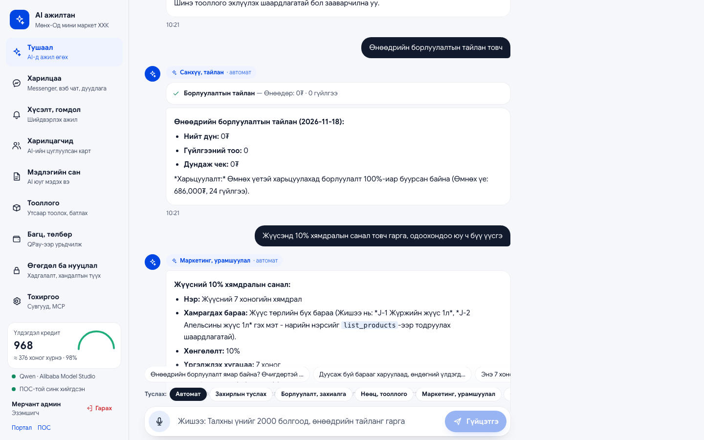 | 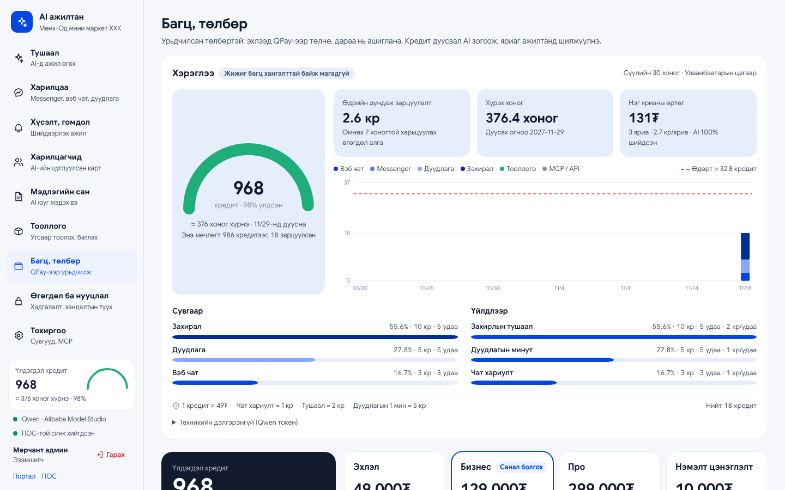 |
| **Тооллого (самбар)** | **Мэдлэгийн сан** |
| 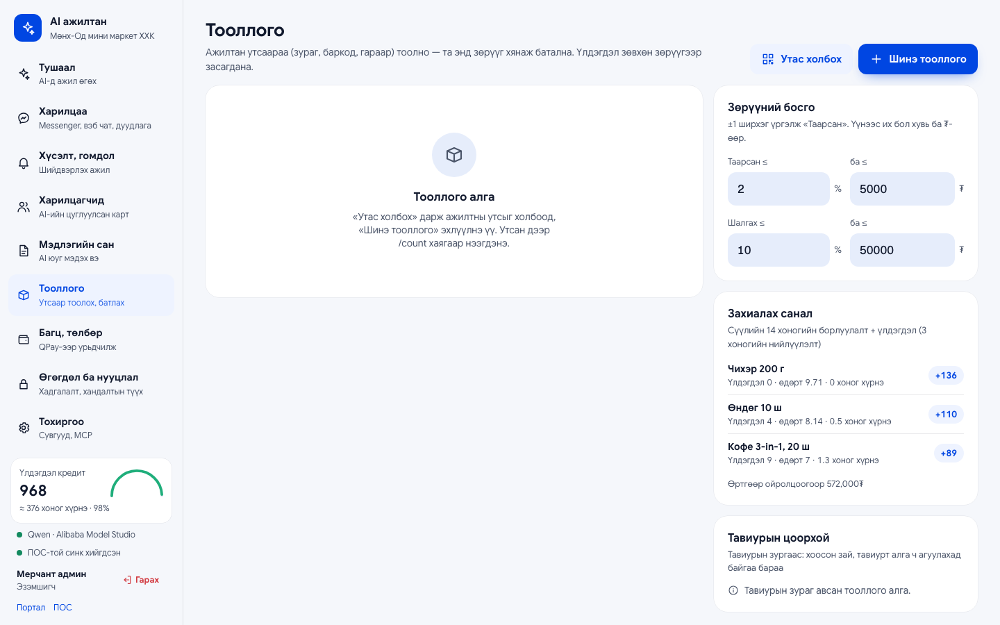 | 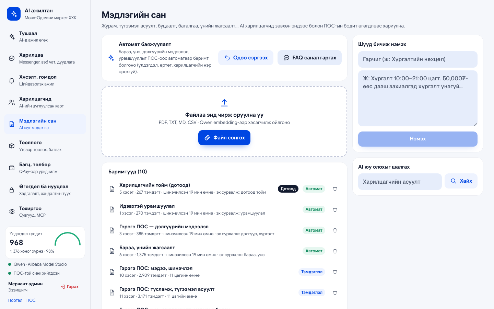 |
| **Түншийн мерчант бүртгүүлэх (`/connect`)** | **Өгөгдөл ба нууцлал** |
| 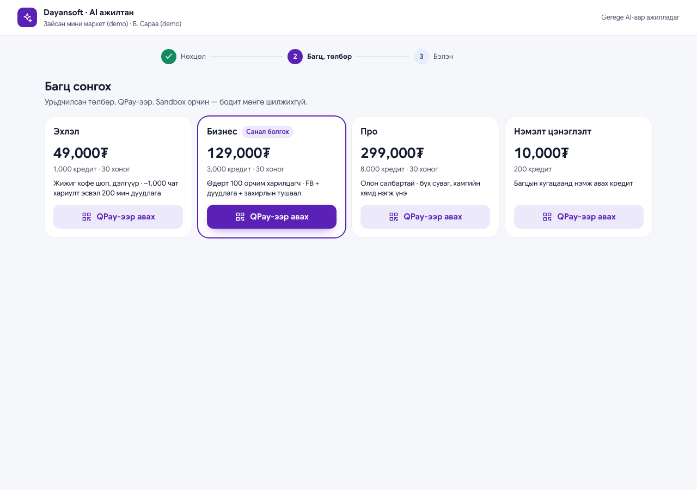 | 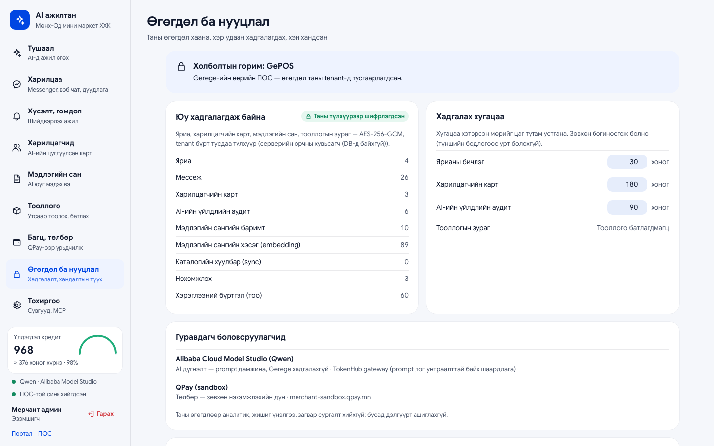 |

<p align="center">
  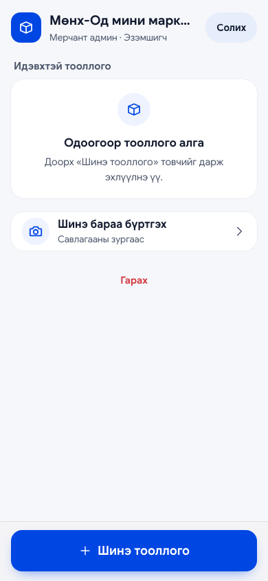
  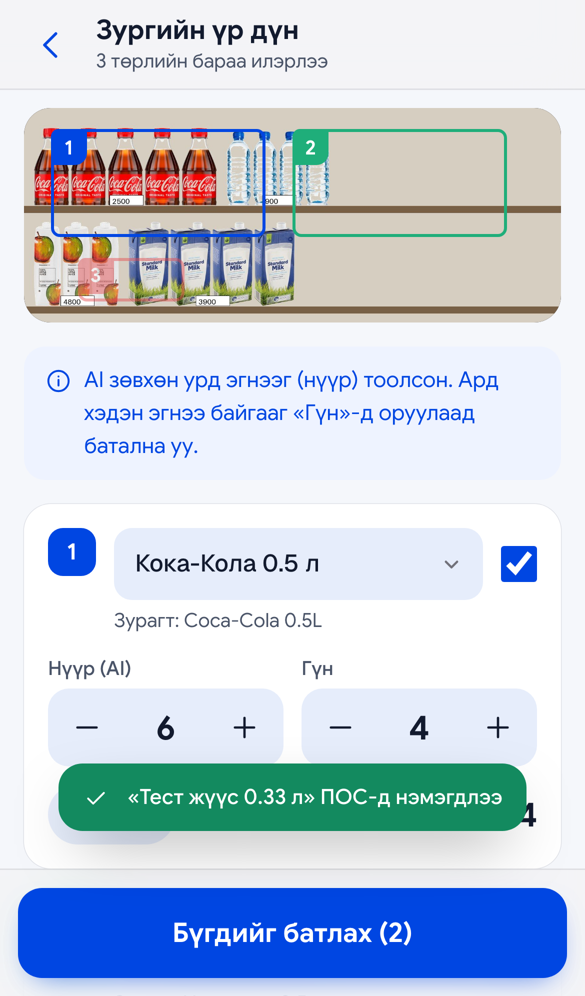
  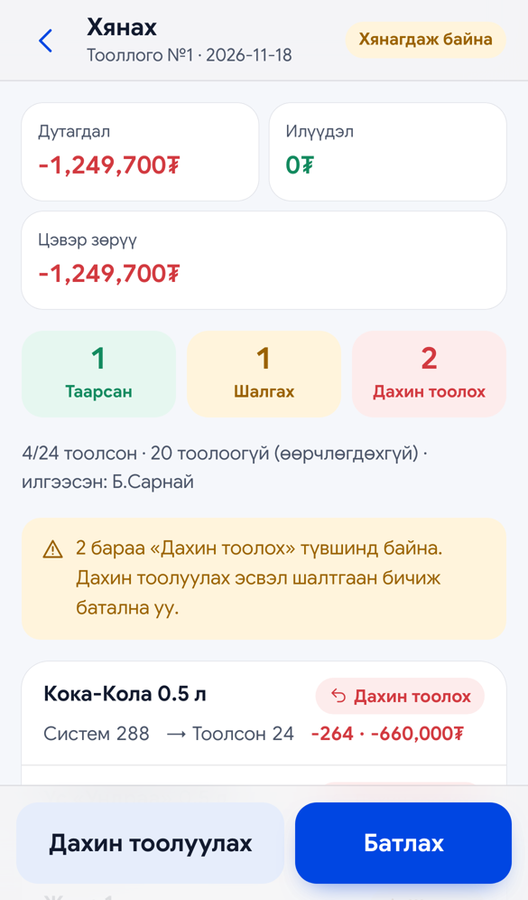
</p>

## Архитектур

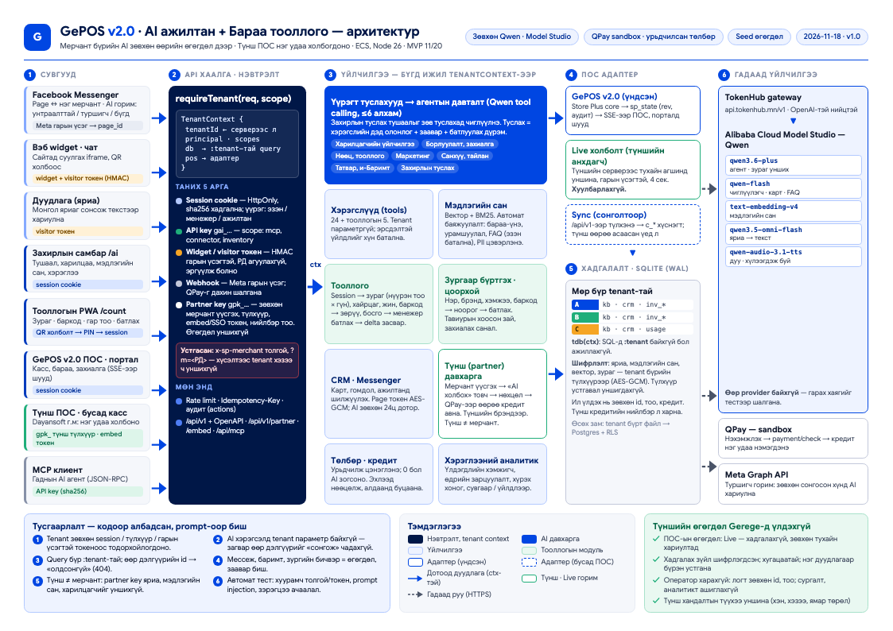

Дэлгэрэнгүй: [`docs/ARCHITECTURE.md`](docs/ARCHITECTURE.md) · нэг хуудас: [PDF](docs/GePOS-v2-AI-architecture.pdf)

| Давхарга | Хэрэгжилт |
|---|---|
| Хаалга, нэвтрэлт | `src/lib/tenant/*`: session cookie (РД+PIN, PWA холболт), API key (scope-той), гарын үсэгтэй widget/visitor токен, webhook гарын үсэг, түншийн түлхүүр |
| AI | `src/lib/agent/*` (Qwen tool-calling, ≤6 алхам), `src/lib/assistants/*` (7 туслах, чиглүүлэлт), `src/lib/kb-auto/*` |
| ПОС адаптер | `src/lib/pos/*`: GePOS v2.0 (шууд), Connector (синк), Live (түншийн кассыг асуух) |
| Тооллого | `src/lib/inventory/*`, `src/app/api/v1/inventory/**`, `src/app/count` |
| Төлбөр | `src/lib/agent/billing.ts`: QPay v2 sandbox, нөөцлөх → тооцох/буцаах |
| Хадгалалт | SQLite (WAL), мерчант бүрийн мөр, шифрлэгдсэн агуулга |

## Qwen загварууд (Alibaba Cloud Model Studio)

| Загвар | Хэрэглээ |
|---|---|
| `qwen3.6-plus` | AI ажилтан (tool calling), тавиурын болон барааны зураг унших |
| `qwen-flash` | Туслах чиглүүлэх, харилцагчийн карт, FAQ олборлолт |
| `text-embedding-v4` | Мэдлэгийн сангийн вектор хайлт |
| `qwen3.5-omni-flash` | Дуудлага: яриаг текст болгох |
| `qwen-audio-3.1-tts-flash` (монгол хоолой «Аялгуу») | Дуугаар хариулах — gateway endpoint нээгдмэгц идэвхжинэ |

Бүх дуудлага `src/lib/agent/qwen.ts`-аар OpenAI-тэй нийцтэй gateway (TokenHub) → Model Studio руу явна.

> **Ил тод мэдэгдэл:** Qwen-ий монгол TTS-ийг gateway-ээр дамжуулах endpoint хараахан нээгдээгүй тул **дуудлагын дуут хариуг түр хугацаанд Google Gemini TTS** (`gemini-3.8-flash-tts`) гаргаж байна. Сонсох (Qwen Omni), ойлгох, хариулт бодох (qwen3.6-plus) хэсэг бүхэлдээ Qwen. Дуудлагын дэлгэц дээр «Дуу: Gemini» гэж харагдана. `AI_TTS_PROVIDER` тохиргоог устгахад дуут хариу Qwen рүү (эсвэл текст рүү) буцна.

### Model Studio-ийн зарцуулалт
- Апп доторх бүртгэл: **Багц, төлбөр → Техникийн дэлгэрэнгүй (Qwen токен)** 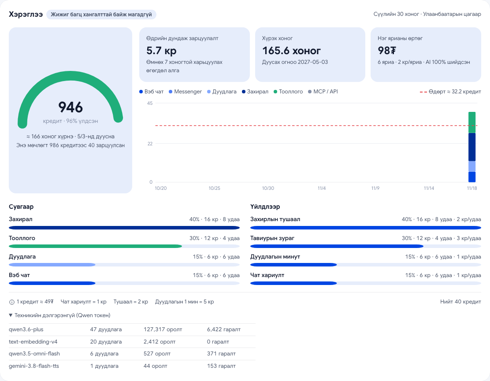
- Model Studio консолын зарцуулалтын зураг: `docs/submission/model-studio-usage.png`

## Үнэ (урьдчилсан, QPay)

| Багц | Үнэ | Кредит | Нэгж |
|---|---|---|---|
| Эхлэл | 49,000₮ | 1,000 | 49₮ |
| **Бизнес** | **129,000₮** | **3,000** | **43₮** |
| Про | 299,000₮ | 8,000 | 37₮ |

Чат хариулт 1 кредит, захирлын тушаал 2, дуудлагын минут 5, тавиурын зураг 3. **Нэг харилцагчийн яриа ≈ 170₮.** Харьцуулбал Intercom Fin ≈ 3,567₮, Tidio Lyro ≈ 2,342₮ нэг яриа тутамд, хүн оператор ≈ 583₮/мин. Эх сурвалж, огноог апп доторх хүснэгтэд заасан.

## Хакатоны шаардлага

| Шаардлага | Хэрэгжилт |
|---|---|
| Realtime inference зөвхөн Qwen (Model Studio) | `src/lib/agent/qwen.ts`. Хуучин Gemini туслах `/api/ai/*` → 404. **Үл хамаарах:** дуудлагын дуут хариу түр Gemini TTS (дээрх мэдэгдлийг үз), `AI_TTS_PROVIDER`-ээр унтарна |
| Бүх төлбөр урьдчилсан, QPay | `billing.ts`: зөвхөн **sandbox** (production URL-ийг код хориглоно). Кредит 0 бол AI зогсоно |
| Өрсөлдөхүйц үнэ, 2–3 үйлчилгээтэй харьцуулалт | Багц, төлбөр хуудас, [слайд](docs/submission/GePOS-v2-AI-slide.pdf) |
| Бодит харилцагчийн өгөгдөл ашиглахгүй | Зөвхөн seed болон зохиомол өгөгдөл. Facebook AI анхдагчаар унтарсан, «бүгдэд хариулах» горимыг сервер хориглоно |

## Ажиллуулах

```bash
npm ci
cp .env.example .env.local   # DASHSCOPE_API_KEY, AI_BASE_URL, AUTH_SECRET, TENANT_KEK …
npm run dev                  # http://localhost:3100/ai
npm test                     # build + 125 тест (mock Qwen/QPay, бодит токен зарцуулахгүй)
```
Node 26 буюу түүнээс шинэ хувилбар шаардлагатай (`node:sqlite`). Серверт байршуулах заавар: [`docs/DEPLOY.md`](docs/DEPLOY.md) (`deploy/install.sh` — Caddy HTTPS + systemd).

## Тест

| Багц | Юуг шалгадаг |
|---|---|
| `isolation` | Tenant хооронд өгөгдөл задрахгүй, хуурамч толгой/токен, prompt injection, зэрэгцээ ачаалал |
| `partner`, `connector` | Түнш өөр түншийн мерчантад хүрэхгүй, түнш мерчантын өгөгдлийг уншихгүй, шууд горимд өгөгдөл хадгалахгүй, устгалт |
| `inventory` | 5 тоолох арга, зөрүү (тоолох үеийн борлуулалттай), давхар батлах 409, зураг шалгалт |
| `messenger`, `assistants-kb`, `content-crypto` | 24 цагийн дүрэм, туслахын эрх, хувийн мэдээлэл цэвэрлэх, DB-д ил текст үлдэхгүй |

## Баримт бичиг
[Архитектур](docs/ARCHITECTURE.md) · [Түншийн гарын авлага](docs/PARTNER_QUICKSTART.md) · [Түншийн connector OpenAPI](docs/partner-connector-openapi.yaml) · [AI ажилтан](docs/AI_EMPLOYEE.md) · [Зургийн тооллогын нарийвчлал](docs/inventory-vision-accuracy.md) · [Байршуулалт](docs/DEPLOY.md)
